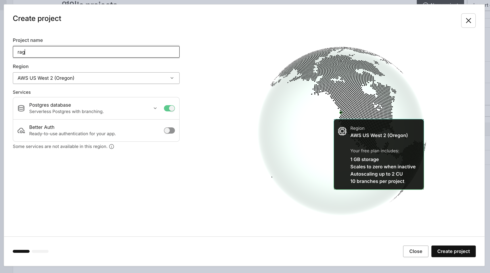
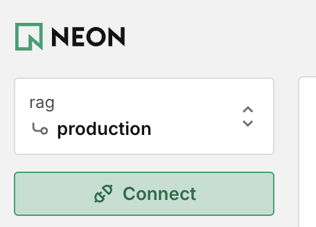
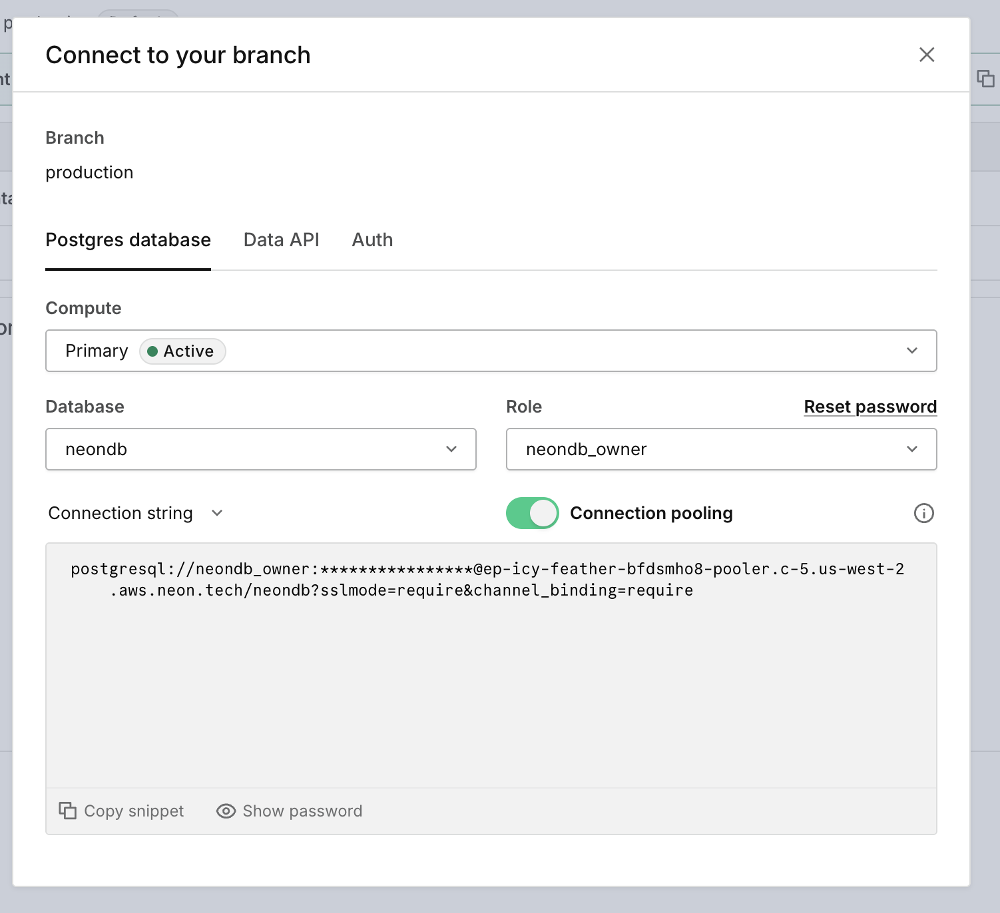
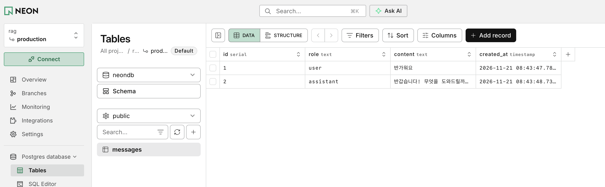

```sh
node -v
git -v
```

```
solid, hono, shadcn, langchainjs, npm, vite, cloudflare 기반으로 간단한 챗봇을 위한 구현 진행. 5분 이내로.
```

- https://aistudio.google.com/apikey

```sh
#.dev.vars
GEMINI_API_KEY=
```

```sh
# Gemini 3.5 Flash Lite
# Gemini 3.1 Flash Lite
# Gemma 4 26B
GEMINI_API_KEY 를 활용하여 Gemini 3.5 Flash Lite 로 LLM 엔진을 적용
```

- https://console.neon.tech/







```sh
# .dev.vars
NEON_CONNECTION_URL=
```

```
NEON_CONNECTION_URL 을 바탕으로 drizzle로 채팅 메모리를 구현. 사용자는 구별하지 않음.
```

```sh
# 스키마 명령어 실행
npm run db:push
```



```
Gemini Embedding 2 와 pgvector를 활용하여 업로드한 pdf를 적절히 청킹하여 rag로 활용할 수 있게 하는 etl을 구성. pdf 업로드 페이지가 산출물.
```

```sh
npm run db:setup
```

```
저장된 벡터를 검색해서 검색증강생성(rag)를 구현.
```

```
.dev.vars를 바탕으로 secret put을 하고, workers로 배포.
```

```
npx wrangler login
```
